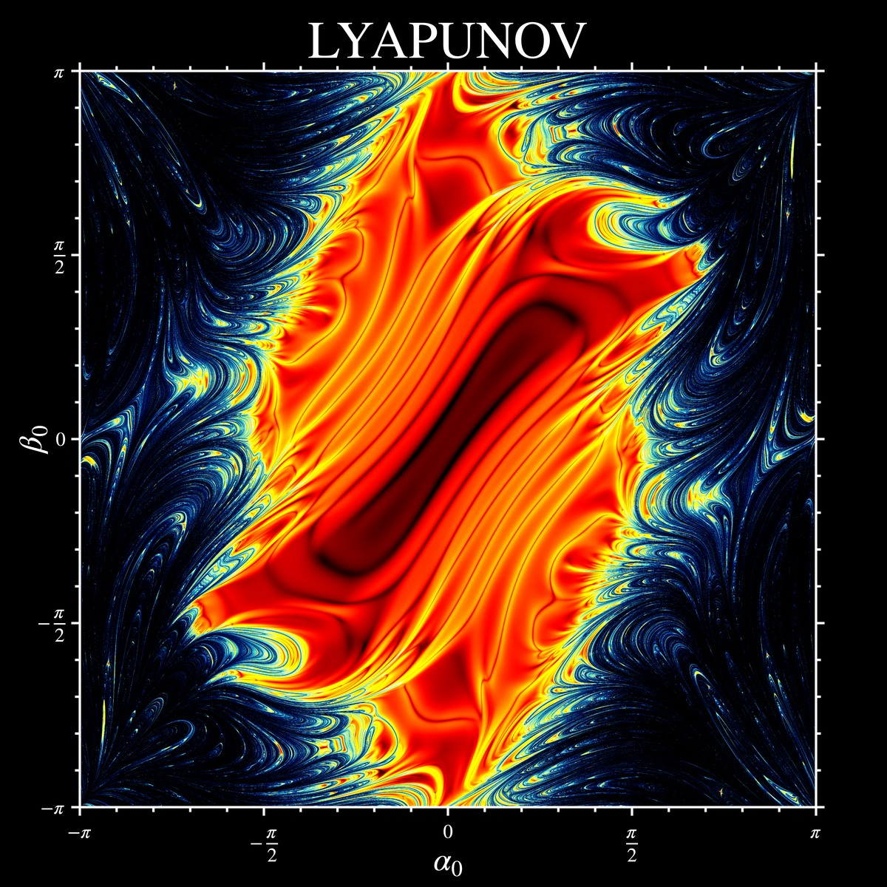

# Double Pendulum Simulations

  

MATLAB simulations of the double pendulum: animated single trajectories and "fractal" chaos maps over all initial angles.

The chaos map above shows, for every pair of initial angles $(\alpha_0, \beta_0)$ (released from rest), how strongly two almost identical pendulums (initial angles perturbed by $\varepsilon = 10^{-5}$ rad) diverge over time. The colour is the logarithm of that divergence, a finite-time, Lyapunov-like measure of chaos. Dark blue regions are chaotic, while red/black regions are regular. The full-resolution image (6300 × 6300 px) is `double_pendulum_gg_TitleLabelTicksR300.png`.

## Main files

| File | Description |
|---|---|
| `Pendulum_Double.m` | Animates a single double pendulum and plots its kinetic, potential and total energy to check energy conservation. Compares `ode45` with a fixed-step RK4 integrator. Contains a list of initial angles that give nice-looking trajectories. |
| `Pendulum_Double_Fractal_CPU.m` | Chaos map on the CPU using `ode45`. Simple, but slow for large grids. |
| `Pendulum_Double_Fractal_GPUacc.m` | Chaos map on the GPU: all pendulums of the grid are integrated in parallel with a vectorized RK4. Uses symmetry to compute only half of the map. |
| `Pendulum_Double_Fractal_GPUacc_5Point.m` | Like `_GPUacc`, but compares each pendulum to four perturbed neighbours (±α, ±β), with separate metrics for position, velocity and full state. |
| `Pendulum_Double_Fractal_GPUacc_CalculusOfVariations.m` | Instead of simulating perturbed copies, integrates the linearized (variational) equations alongside the pendulum to track how a small perturbation grows. |

Helper functions:
- `pendulum_double_*_rhs.m`: equations of motion (angle or Cartesian coordinates)
- `*_J.m`, `*_Jdx_vectorized.m`, `*_aug_variational*.m`: Jacobians and variational equations

Other scripts:
- `Pendulum.m`: simple pendulum
- `Pendulum_Double_MultiPlot.m`: animates several double pendulums with almost identical initial angles to visualize how they diverge
- `Pendulum_SymMath.m`: derives the equations of motion and Jacobians symbolically (Lagrangian mechanics) and writes them as `.m` functions
- `Image_Renderer.m`: renders the final chaos map from the `.mat` files saved by `Pendulum_Double_Fractal_GPUacc_5Point.m`

## Requirements

- MATLAB
- **Parallel Computing Toolbox** and a supported NVIDIA GPU for the `_GPUacc` scripts
- **Symbolic Math Toolbox** for `Pendulum_SymMath.m`
- Colormaps from MATLAB File Exchange, used by the fractal scripts:
  - [`slanCM`](https://www.mathworks.com/matlabcentral/fileexchange/120088-200-colormap) (all fractal scripts)
  - [`inferno`, `magma`, `viridis`, `twilight_shifted`](https://www.mathworks.com/matlabcentral/fileexchange/51986-perceptually-uniform-colormaps) (`_CalculusOfVariations`)
